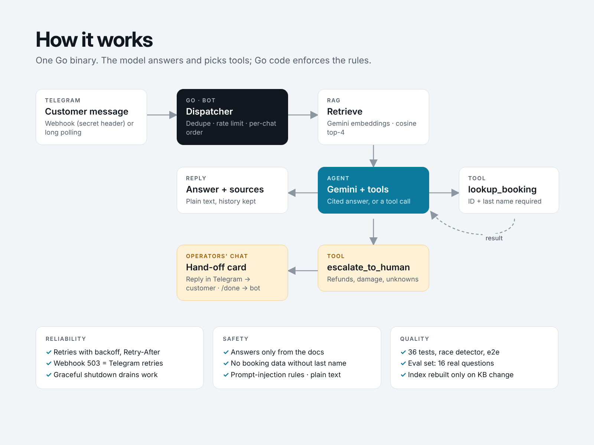

# AI Support Agent for Telegram — Go, Gemini, RAG, human hand-off

A customer-support bot that **answers from the company's own documents with sources**, **checks bookings through a tool**, and **hands the chat to a real person** when it should — refunds, damage, angry customers or anything not in the docs. Operators answer from a Telegram group; the customer never leaves the chat.

Written in Go with **zero third-party dependencies**: one static binary, one Docker image.



## Why this design

Most "AI chatbots" either hallucinate prices or say "I don't know" and leave the customer stuck. This one:

- **Retrieves before it answers.** The knowledge base (Markdown files) is split into sections, embedded with Gemini and searched by cosine similarity. Only relevant sections reach the model, and the answer cites them — the bot appends the source titles.
- **Acts through tools, not guesses.** `lookup_booking` reads the booking system; it requires the booking ID **and** the last name, and a wrong name looks exactly like a missing booking, so nobody can probe other people's bookings.
- **Knows its limits.** `escalate_to_human` is called for unknown questions, refunds, damage and "can I talk to a person". The bot posts a hand-off card to the operators' Telegram group; an operator replies to the card and the customer gets the answer. `/done` hands the chat back to the bot. Customers can also type `/human` at any time.

## Features

| Area | What's implemented |
|---|---|
| Channels | Telegram webhook (secret-header check, constant-time compare) or long polling for local dev |
| RAG | Markdown → sections → `gemini-embedding-2` (768 dims) → in-memory cosine search; index cached to JSON and rebuilt only when the docs or model change |
| Agent | `gemini-3.8-flash` with function calling; thought signatures echoed back; max tool rounds; empty answers escalate |
| Hand-off | Operator group, reply-to-relay, `/done`, `/human`, 30-min hand-off timeout, fallback email if no operators configured |
| Conversation | Per-chat history (last 4 exchanges), follow-up questions use the previous message for retrieval |
| Concurrency | Worker pool sharded by chat ID: chats run in parallel, messages of one chat stay in order |
| Reliability | Retries with exponential backoff and `Retry-After`; webhook returns 503 when the queue is full so Telegram retries; update-ID dedupe; graceful shutdown drains in-flight work |
| Safety | Plain-text replies (no Markdown injection), prompt-injection rules, API keys only in headers, bot token never in logs or errors, per-chat rate limit (10 msg/min) |
| Ops | Structured JSON logs (no message content), `/healthz`, distroless non-root Docker image |

## Try it in 5 minutes (no server needed)

```bash
cp .env.example .env              # add GEMINI_API_KEY and TELEGRAM_BOT_TOKEN (from @BotFather)
export $(grep -v '^#' .env | xargs)

go run ./cmd/supportbot ask "How much is an e-bike for a day?"   # terminal only, no Telegram
go run ./cmd/supportbot                                          # MODE=polling: talk to your bot
```

For hand-offs, add the bot to a Telegram group, send a message there, and put the group's chat ID into `ADMIN_CHAT_ID`.

Demo booking to try: `PP-1042`, last name `Hansen`.

## Deploy (webhook)

```bash
docker build -t supportbot .
docker run -p 8080:8080 --env-file .env -e MODE=webhook \
  -e PUBLIC_URL=https://your-domain -e WEBHOOK_SECRET=$(openssl rand -hex 16) supportbot
```

Works on Fly.io, Render, Railway, Cloud Run or any VPS. The bot calls `setWebhook` itself on start.

## Quality

```bash
go test -race ./...          # 36 tests: unit, integration with fake servers, one end-to-end run of the binary
GEMINI_API_KEY=... go run ./cmd/eval   # 16 real questions against the real API
```

- **Unit / integration:** Gemini client against an HTTP test server (retries, Retry-After, 4xx fail-fast, batching, task prefixes), agent tool loop with a scripted model, hand-off flow, rate limit, dedupe, webhook security, per-chat ordering under the race detector.
- **End-to-end:** `cmd/supportbot/main_test.go` starts the real `run()` against fake Gemini and Telegram servers, receives a message by polling, answers with sources, then shuts down via SIGINT.
- **Evals:** `eval/cases.json` checks answers (must contain the right price, cite the right article), tool use, hand-offs (motorbikes, crashes, refunds) and a prompt-injection attempt. Run it after every change to the prompt or the docs.

Coverage: 80–94 % per package.

## Adapting it to a real business

1. Replace the Markdown files in `kb/` with the client's FAQ, policies and price lists.
2. Replace `internal/bookings` with a call to their system (Shopify orders, a booking API, a CRM).
3. Update `eval/cases.json` with 20–30 real customer questions and keep it green.

Other channels (WhatsApp Cloud API, website widget, Slack) only need a new adapter next to `internal/telegram`; the agent and hand-off logic stay the same.

## Project structure

```
cmd/supportbot     main: config, wiring, polling/webhook, `ask` and `index` subcommands
cmd/eval           evaluation runner
internal/gemini    REST client: generate with tools, batch embeddings, retries
internal/kb        Markdown chunking, vector index, persistence
internal/agent     RAG + tool loop, citations, escalation
internal/bookings  demo booking store (the tool's backend)
internal/telegram  Bot API client, long polling, webhook handler
internal/bot       conversation state, rate limit, hand-off, dispatcher
kb/                demo knowledge base (fictional bike rental in Tromsø)
data/              demo bookings; index.json is generated
eval/              evaluation cases
```

## Limits

State (history, active hand-offs) is in memory: fine for one instance and restarts are harmless, but running several replicas would need Redis or a database. The vector index is in memory too — right for up to tens of thousands of chunks; beyond that use pgvector or a vector DB.
